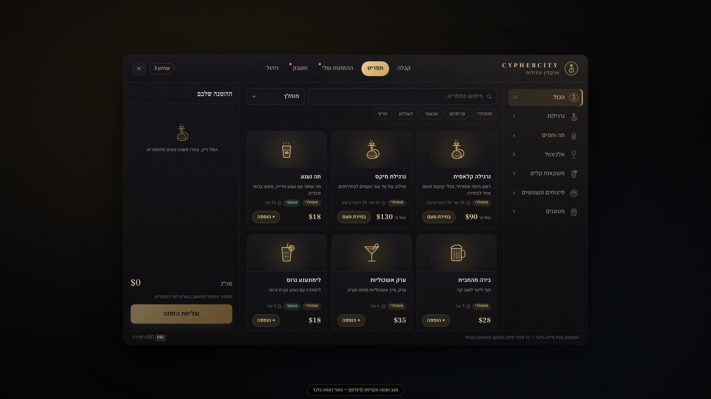
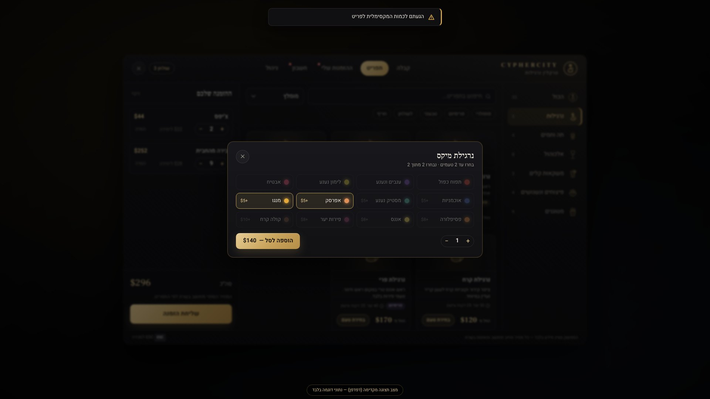
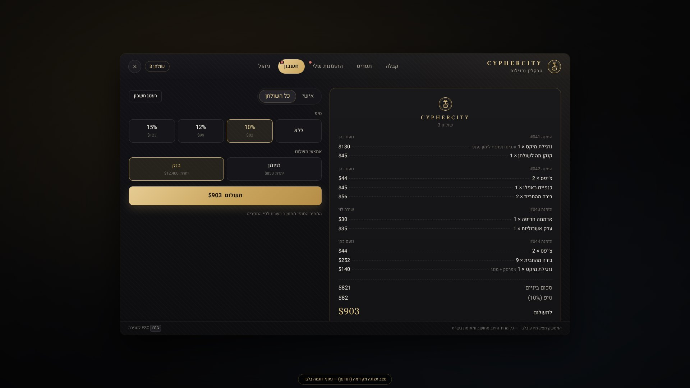
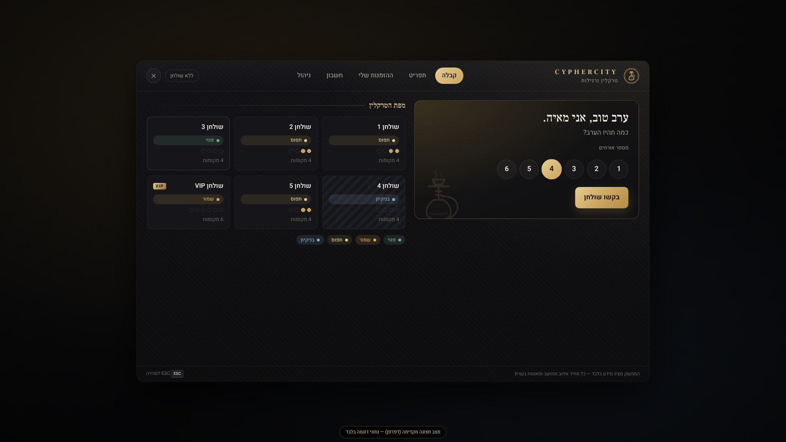
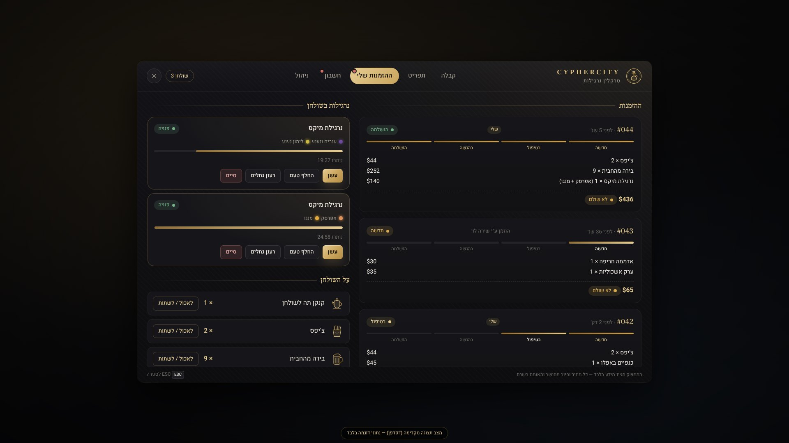
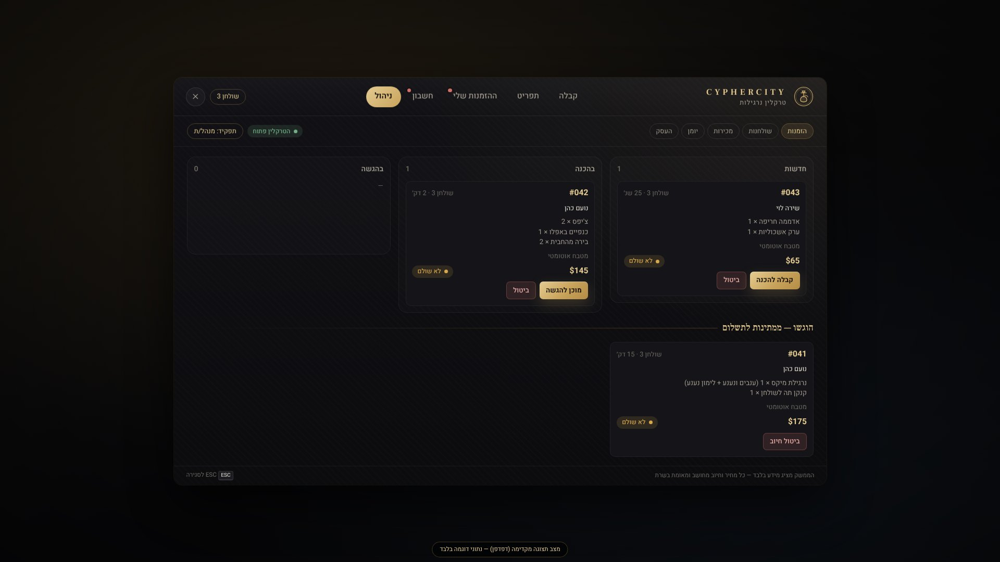

# CypherCity — Hookah Lounge

משאב FiveM לעסק הנרגילות של שרת CypherCity.

* **המשאב עצמו:** התיקייה [`cyphercity-hookah`](cyphercity-hookah). מעתיקים אותה לתיקיית ה-resources בשרת.
* **הוראות התקנה והגדרה (עברית):** [`cyphercity-hookah/README.md`](cyphercity-hookah/README.md)
* **בדיקות:** [`cyphercity-hookah/tests/README.md`](cyphercity-hookah/tests/README.md)
* **צילומי מסך של הממשק:** [`docs/screenshots`](docs/screenshots)

| תפריט | בחירת טעמים | חשבון |
|---|---|---|
|  |  |  |
| **מארחת** | **מעקב הזמנות** | **ניהול** |
|  |  |  |

> צילומי המסך נלקחו מהממשק האמיתי בדפדפן Chromium, עם נתוני דוגמה שנבנו מתוך `config.lua`.

