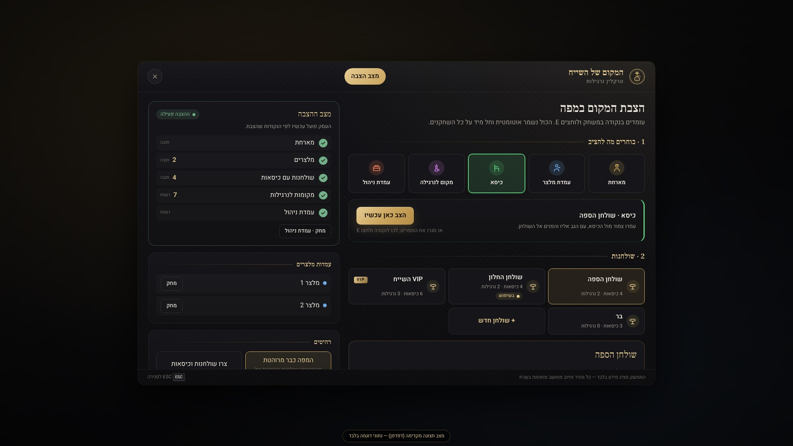
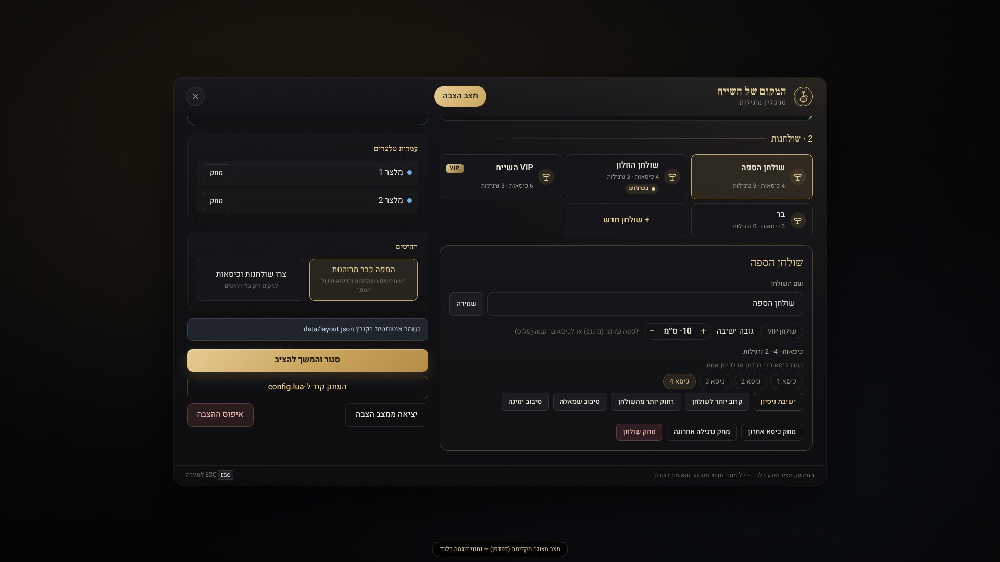
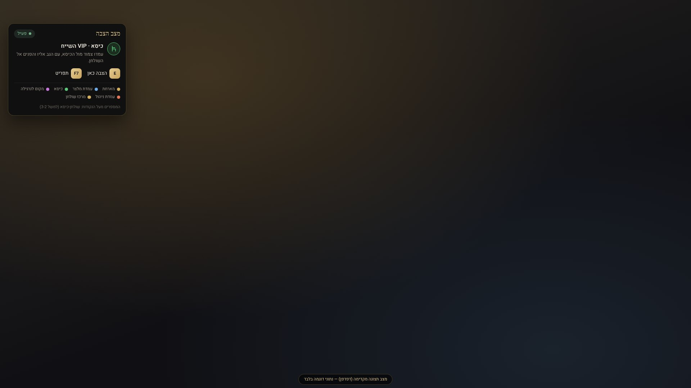

<div dir="rtl">

# המקום של השייח — `cyphercity-hookah`

משאב FiveM מלא לעסק הנרגילות "המקום של השייח" בשרת CypherCity: מארחת בכניסה, הקצאת שולחנות, מלצרים, נרגילות עם טעמים, תפריט מזון ומשקאות, חשבון ותשלום, פאנל ניהול לעובדים, לוגים ואבטחה בצד השרת. הממשק בעברית מלאה (RTL), בעיצוב כהה עם גווני זהב.

> **סטטוס:** הקוד נבדק אוטומטית מחוץ למשחק: 125 בדיקות לוגיקה, 14 בדיקות ממשק בדפדפן, בדיקות הצלבה ובדיקה של כל ה-natives מול התיעוד הרשמי (פירוט ב-`tests/README.md`).
> **הוא לא נבדק בתוך שרת FiveM חי**, כי לא הייתה לי גישה לשרת שלכם. לפני העלאה לשרת הייצור צריך להריץ אותו בשרת בדיקה ולעבור על רשימת הבדיקות בהמשך.

---

## תוכן עניינים

1. [מה יש במשאב](#מה-יש-במשאב)
2. [דרישות מוקדמות](#דרישות-מוקדמות)
3. [זיהוי ה-Framework וה-Inventory בשרת שלכם](#זיהוי-ה-framework-וה-inventory-בשרת-שלכם)
4. [תלויות](#תלויות)
5. [התקנה](#התקנה)
6. [דוגמה ל-server.cfg](#דוגמה-ל-servercfg)
7. [הצבת המקום במפה מתוך המשחק — /hookahsetup (הדרך הקלה)](#הצבת-המקום-במפה-מתוך-המשחק--hookahsetup-הדרך-הקלה)
8. [הגדרת מיקום העסק, המארחת, המלצרים והשולחנות (ידנית בקובץ)](#הגדרת-מיקום-העסק-המארחת-המלצרים-והשולחנות-ידנית-בקובץ)
9. [מחירים, קטגוריות, נרגילות וטעמים](#מחירים-קטגוריות-נרגילות-וטעמים)
10. [Job, דרגות והרשאות](#job-דרגות-והרשאות)
11. [תשלומים וחשבון העסק](#תשלומים-וחשבון-העסק)
12. [אינבנטורי (אופציונלי)](#אינבנטורי-אופציונלי)
13. [לוגים ונתונים](#לוגים-ונתונים)
14. [בדיקות אחרי ההפעלה](#בדיקות-אחרי-ההפעלה)
15. [פתרון תקלות נפוצות](#פתרון-תקלות-נפוצות)
16. [השבתה והסרה בטוחה](#השבתה-והסרה-בטוחה)
17. [מגבלות ידועות](#מגבלות-ידועות)
18. [אבטחה — מה השרת בודק](#אבטחה--מה-השרת-בודק)
19. [מבנה הקבצים](#מבנה-הקבצים)
20. [נספח: ה-API של כל מערכת שהמשאב משתמש בו](#נספח-ה-api-של-כל-מערכת-שהמשאב-משתמש-בו)

---

## מה יש במשאב

| תחום | מה עובד |
|---|---|
| **מארחת** | NPC בכניסה, פאנל קבלה ("כמה תהיו הערב?"), הקצאה אוטומטית של השולחן הקטן ביותר שמתאים, מפת שולחנות עם סטטוסים, סימון זהב מעל השולחן שהוקצה. |
| **שולחנות** | ארבעה מצבים: פנוי, שמור, תפוס ובניקיון. כמות מקומות לפי קיבולת, הזמנת חברים לשולחן, העברת בעלות כשהמארח עוזב, ושחרור אוטומטי בעזיבה, בניתוק או ביציאה מהעסק. |
| **מלצרים** | NPC מלצרים לפי אזורי שולחנות. דרכם מזמינים, צופים בהזמנות ומבקשים חשבון. כשהזמנה יוצאת להגשה, המלצר הולך אל השולחן וחוזר. |
| **הזמנות** | מצבי הזמנה: חדשה, בטיפול, בהגשה והושלמה. אפשר להפעיל מטבח אוטומטי, עבודה של עובדים בלבד, או שילוב של השניים (ברירת המחדל). ללקוח יש מעקב חי, וההזמנה מוגשת לשולחן בסוף. אפשר לצרף **הערה למטבח** (לדוגמה "בלי קרח"), ויש כפתור **"קרא למלצר"**. |
| **נרגילות** | 5 סוגים ו-12 טעמים (אפשר לשנות). יש נרגילת מיקס של שני טעמים, ונרגילת פרי עם רשימת טעמים מוגבלת. הנרגילה משויכת לשולחן. כל היושבים יכולים לעשן ממנה, אבל רק אחד בכל פעם. אפשר להחליף טעם ולרענן גחלים בתשלום, יש טיימר, ובסוף הנרגילה נגמרת לבד. |
| **תפריט** | תה וחמים, אלכוהול, משקאות קלים, פיצוחים, אדממה, ומטוגנים: צ'יפס, טבעות בצל, שניצלונים, כנפיים, מקלות גבינה ועוד. בממשק יש חיפוש, סינון לפי תגיות ומיון. |
| **חשבון** | חשבון אישי או חשבון לכל השולחן, טיפ לבחירה, דמי שירות אופציונליים, בחירה בין מזומן לבנק, מסך אישור וקבלה מפורטת. |
| **ניהול** | הזמנות בלוח עם עמודות לפי מצב, ניהול שולחנות (ניקיון, שמירה, שיבוץ אורח, שליחת חשבון, שחרור), מכירות של היום ושל 7 הימים האחרונים, מלאי (אופציונלי), יומן אירועים, ופתיחה וסגירה של העסק. **מלצר (שחקן) יכול לקחת הזמנה לשולחן**: היא נשלחת למטבח ומתווספת לחשבון השולחן. |
| **הצבה במשחק** | מנהל שרת מקליד `/hookahsetup` בתוך המקום של השייח, עומד בכל נקודה ולוחץ E: מארחת, מלצרים, כיסאות, נרגילות ועמדת ניהול. הכול נשמר אוטומטית וחל מיד על כל השחקנים, בלי לערוך קבצים. |
| **תאימות** | ESX Legacy, QBCore, Qbox ו-Standalone. ox_target, qb-target או מקש E מובנה. ox_lib, התראות של ה-Framework או התראות מובנות. ox_inventory, qb-inventory, ESX, או בלי אינבנטורי בכלל. |

צילומי מסך של הממשק נמצאים בתיקייה [`docs/screenshots`](../docs/screenshots) (בשורש המאגר).

---

## דרישות מוקדמות

* שרת FiveM עדכני (`fx_version cerulean`, Lua 5.4).
* **OneSync מופעל.** בלי OneSync השרת לא רואה את מיקום השחקנים, ובדיקות המרחק מושבתות. במקרה כזה תופיע אזהרה בקונסולה. ESX Legacy, QBCore ו-Qbox דורשים OneSync בכל מקרה.
* אחד מאלה: ESX Legacy (`es_extended`), QBCore (`qb-core`), Qbox (`qbx_core`), או מצב Standalone ללא Framework.
* **לא צריך מסד נתונים.** המשאב לא יוצר טבלאות SQL.

---

## זיהוי ה-Framework וה-Inventory בשרת שלכם

אין לי גישה לשרת שלכם, ולכן לא יכולתי לבדוק מה מותקן בו. כדי לברר:

1. התקינו את המשאב (ראו [התקנה](#התקנה)) והפעילו את השרת.
2. ב-**txAdmin ← Live Console** הקלידו:
   ```
   hookahdiag
   ```
3. הכלי מדפיס:
   * איזה Framework, אינבנטורי ומערכת כסף זוהו בפועל.
   * רשימת המשאבים הרלוונטיים שקיימים בשרת, עם המצב והגרסה של כל אחד.
   * האם OneSync מופעל, ואיזה Game Build רץ.
   * שגיאות ואזהרות בהגדרות (`config.lua`).
   * מצב חי: שולחנות תפוסים, הזמנות פעילות, נרגילות ועובדים במשמרת.

ב-`config.lua` ברירת המחדל היא `Config.Framework = 'auto'`, והזיהוי נעשה בסדר הזה:

| מה קיים בשרת | מה ייבחר |
|---|---|
| `qbx_core` | Qbox. הוא נבדק ראשון, כי Qbox מציג את עצמו גם בשם `qb-core`. |
| `qb-core` | QBCore |
| `es_extended` | ESX |
| אף אחד מהם | Standalone. תופיע אזהרה בולטת בקונסולה. |

### זיהוי ידני, בלי להתקין שום דבר

ב-**txAdmin ← Resources** (או בתיקיית `resources` של השרת, ובשורות `ensure` בקובץ `server.cfg`), חפשו את השמות האלה:

| אם קיים משאב בשם | זה אומר |
|---|---|
| `qbx_core` | השרת על **Qbox** (גם אם יש `qb-core` — ב-Qbox הוא חלק מ-qbx_core) |
| `qb-core` (בלי `qbx_core`) | השרת על **QBCore** |
| `es_extended` | השרת על **ESX** |
| `ox_inventory` / `qb-inventory` | מערכת האינבנטורי |
| `ox_target` / `qb-target` | מערכת ה-Target (העין) |
| `ox_lib` | ספריית ox_lib (התראות) |
| `qb-banking` / `Renewed-Banking` / `esx_addonaccount` | מערכת הבנק של חשבונות עסק |

אין צורך לשנות שום הגדרה לפי זה, כי ברירת המחדל (`'auto'`) מזהה לבד. הטבלה עוזרת להבין מה `hookahdiag` מדווח.

אם Framework קיים בשרת אבל עדיין עולה, המשאב מחכה לו עד 20 שניות. אם הוא קיים אבל **לא** עלה, המשאב **לא** עובר למצב חינם. הוא נעצר ומדפיס הודעת שגיאה עם הוראות תיקון.

---

## תלויות

**אין אף תלות חובה.** כל המערכות הבאות הן אופציונליות ומזוהות אוטומטית:

| מערכת | שם המשאב | מה המשאב עושה איתה |
|---|---|---|
| Framework | `es_extended` / `qb-core` / `qbx_core` | זהות השחקן, Job ודרגה, כסף. |
| Target | `ox_target` / `qb-target` | אינטראקציה דרך העין. בלעדיהם: מקש **E** עם תפריט מובנה. |
| התראות | `ox_lib` | התראות דרך `ox_lib:notify`. בלעדיו: התראות ה-Framework או ההתראות המובנות. |
| אינבנטורי | `ox_inventory` / `qb-inventory` / ESX | רק אם תגדירו `Config.Inventory`. ברירת המחדל היא `'none'` (מצב קטלוג). |
| חשבון העסק | `esx_addonaccount` / `qb-banking` / `Renewed-Banking` | רק אם תפעילו `Config.Payments.society.enabled`. |
| רעב וצמא | `esx_status` / מטא-דאטה של QBCore ו-Qbox | רק אם תפעילו `Config.Status.enabled`. |

הגופנים (Heebo ו-Frank Ruhl Libre, ברישיון OFL) והאייקונים כלולים בתוך המשאב. **הממשק לא טוען שום דבר מהאינטרנט.**

---

## התקנה

1. העתיקו את התיקייה `cyphercity-hookah` לתיקיית ה-resources של השרת, לדוגמה:
   `resources/[cyphercity]/cyphercity-hookah`
   **שם התיקייה חייב להיות בדיוק `cyphercity-hookah`.**
2. הוסיפו ל-`server.cfg` שורת `ensure` **אחרי** ה-Framework, ה-Target וה-ox_lib (ראו דוגמה למטה).
3. הפעילו מחדש את השרת, או הקלידו בקונסולה:
   ```
   refresh
   ensure cyphercity-hookah
   ```
4. חפשו בקונסולה את השורה:
   ```
   [cyphercity-hookah] Ready — framework: qbcore | inventory: none | money: money | tables: 6 | products: 34
   ```
5. הריצו `hookahdiag` וודאו שהזיהוי נכון.

> התיקייה `tests` לא נטענת למשחק (היא לא מופיעה ב-`fxmanifest.lua`). אפשר להשאיר אותה או למחוק אותה מהשרת.

---

## דוגמה ל-server.cfg

השינויים האלה לא הוכנסו אוטומטית לשרת שלכם. הוסיפו אותם בעצמכם.

```cfg
# ── קודם כל התשתית (הסדר חשוב) ──
ensure oxmysql
ensure ox_lib
ensure qb-core            # או es_extended / qbx_core
ensure ox_target          # או qb-target (לא חובה)
ensure ox_inventory       # לא חובה

# ── המשאב ──
ensure cyphercity-hookah

# ── הרשאות ──
# כלי ההצבה במשחק (/hookahsetup), כלי האבחון ופקודת הקואורדינטות — למנהלי השרת:
add_ace group.admin cyphercity.hookah.admin allow
# מתן תפקיד "מנהל עסק" דרך ACE (שימושי במצב Standalone):
# add_ace group.admin cyphercity.hookah.manager allow

# ── לוגים ל-Discord (לא חובה) ──
# set ולא setr! setr חושף את הערך לשחקנים.
# set cyphercity_hookah_webhook "https://discord.com/api/webhooks/XXXX/YYYY"
```

---

## הצבת המקום במפה מתוך המשחק — /hookahsetup (הדרך הקלה)

כך מכניסים את העסק למפה של **המקום של השייח** בלי לערוך קבצים ובלי להעתיק קואורדינטות. נכנסים למקום במשחק, עומדים בכל נקודה ולוחצים על מקש. השרת שומר את המיקום, וכל השחקנים רואים את השינוי מיד.

| תפריט ההצבה | עריכת שולחן | התצוגה בזמן ההצבה |
|---|---|---|
|  |  |  |

### לפני שמתחילים

1. **הרשאה:** הכלי פתוח **רק למנהלי שרת**. הוסיפו ל-`server.cfg` את השורה (אם היא עוד לא שם), והפעילו מחדש את השרת:
   ```cfg
   add_ace group.admin cyphercity.hookah.admin allow
   ```
   גם `Config.Debug = true` **לא** פותח את הכלי לשחקנים רגילים. כך אף אחד לא יכול להזיז לכם את העסק בטעות.
2. **מומלץ:** לעשות את ההצבה כשאין לקוחות בעסק (למשל בשרת בדיקה, או כשהעסק סגור דרך פאנל הניהול).

### צעד אחר צעד

1. היכנסו למקום של השייח במשחק והקלידו בצ'אט:
   ```
   /hookahsetup
   ```
   נפתח **תפריט ההצבה**, ובצד המסך מופיע חלון קטן שמראה מה בחרתם ומה עוד חסר.
2. בתפריט בוחרים **כלי**, ואז לוחצים "סגור והמשך להציב" (או ESC). עכשיו אפשר ללכת במקום כרגיל.
3. עומדים בנקודה הנכונה ולוחצים **E**. זהו: הנקודה נשמרה. בכל רגע אפשר ללחוץ **F7** כדי לפתוח שוב את התפריט.

| כלי | איפה לעמוד |
|---|---|
| **מארחת** | במקום שבו המארחת תעמוד בכניסה, עם הפנים לכניסה. |
| **עמדת מלצר** | בעמדת ההמתנה של המלצר (למשל ליד הבר), עם הפנים לאולם. אפשר כמה מלצרים. כל שולחן מקבל אוטומטית את המלצר הקרוב אליו. |
| **שולחן חדש** | לוחצים "שולחן חדש" בתפריט. השולחן נבחר אוטומטית והכלי עובר ל"כיסא". |
| **כיסא** | **צמוד מול הכיסא, עם הגב אל הכיסא והפנים אל השולחן.** השרת שומר את הכיסא כ-35 ס״מ מאחוריכם, בדיוק במקום הישיבה. חוזרים על זה לכל כיסא בשולחן. |
| **מקום לנרגילה** | במקום שבו הנרגילה תעמוד, על הרצפה ליד השולחן. מספר המקומות קובע כמה נרגילות אפשר להגיש לשולחן. |
| **עמדת ניהול** (רשות) | ליד הקופה או הבר. שם העובדים פותחים את פאנל הניהול. |

4. **העסק נדלק לבד:** ברגע שיש מארחת, לפחות מלצר אחד ושולחן אחד עם כיסא, ההצבה הופכת ל"פעילה". המארחת והמלצרים מופיעים במקום שהצבתם, ומכאן כל שינוי חל מיד. עד אז ההצבה היא "טיוטה", והעסק ממשיך לעבוד לפי `config.lua`.
5. **בדיקת ישיבה:** בתפריט, בחרו שולחן ← בחרו כיסא ← "ישיבת ניסיון". הדמות שלכם מתיישבת בדיוק כמו לקוח. לוחצים E כדי לקום.
   * מרחף או שוקע? "גובה ישיבה" + או −, בצעדים של 5 ס״מ (לכל השולחן, למשל לספה נמוכה).
   * יושב קצת לפני הכיסא או אחריו? "קרוב יותר לשולחן" / "רחוק יותר מהשולחן" (5 ס״מ בכל לחיצה).
   * מסתכל לכיוון לא נכון? "סיבוב שמאלה" / "סיבוב ימינה" (15 מעלות).
6. **רהיטים:** אם במפה של המקום כבר יש שולחנות וכיסאות (MLO), השאירו "המפה כבר מרוהטת" (ברירת המחדל). אם המקום ריק, בחרו "צרו שולחנות וכיסאות", והמשאב ייצור אותם בנקודות שהצבתם.
7. כשסיימתם: "יציאה ממצב הצבה". הכול כבר שמור.

### מה רואים בזמן ההצבה

* **עיגול צבעוני על הרצפה** בכל נקודה שהוצבה: זהב למארחת, כחול למלצר, ירוק לכיסא, סגול לנרגילה, כתום לעמדת הניהול, וזהב גדול במרכז כל שולחן.
* **קו קצר** מכל נקודה מראה לאן הדמות תסתכל.
* **מספרים** מעל הנקודות: מספר המלצר, או "שולחן-כיסא" (למשל `3-2` = שולחן 3, כיסא 2). המשחק עצמו לא יודע להציג עברית, ולכן מוצגים מספרים בלבד. המקרא בעברית מופיע בחלון הקטן בצד המסך.
* **עיגול מתחת לרגליים** מראה איפה תישמר הנקודה אם תלחצו E עכשיו.

### שמירה, ביטחון ושחזור

* **שמירה אוטומטית** אחרי כל לחיצה, לקובץ `data/layout.json` בתוך תיקיית המשאב. אחרי הפעלה מחדש של השרת, ההצבה חוזרת לבד.
* **שולחן שיושבים בו לקוחות לא משתנה.** אי אפשר להזיז, למחוק או לשנות כיסאות של שולחן תפוס (או בניקיון). מקבלים הודעה, ואפשר לנסות שוב כשהוא מתפנה. שינוי שם או VIP מותר תמיד.
* **העסק לא נשאר בלי בסיס:** כשההצבה פעילה, אי אפשר למחוק את המלצר האחרון או את השולחן האחרון.
* **הגנה מטעויות:** נקודה שרחוקה יותר מ-150 מטר משאר ההצבה נדחית, וגם נקודה כפולה (כמעט באותו מקום). יש מגבלות: עד 8 מלצרים, 30 שולחנות, 12 כיסאות לשולחן ו-6 נרגילות לשולחן.
* **כל שינוי נרשם ביומן** (קטגוריה "הצבה"), עם שם המנהל.
* **איפוס:** "איפוס ההצבה" בתפריט (עם אישור) מוחק את ההצבה, והעסק חוזר למיקומים שב-`config.lua`. אפשר גם למחוק את `data/layout.json` ולהפעיל מחדש את המשאב.
* **גיבוי בקובץ (לא חובה):** "העתק קוד ל-config.lua" מעתיק את ההצבה כקוד מוכן. אם תדביקו אותו בסוף `config.lua`, ההצבה תישמר גם בקובץ ההגדרות.

### הערות

* **המקשים** E ו-F7 הם ברירת מחדל. כל מנהל יכול לשנות אותם אצלו: הגדרות המשחק ← Key Bindings ← FiveM. השם שם מופיע באנגלית ("Sheikh's Place setup"), כי תפריט ההגדרות של המשחק לא מציג עברית. את ברירת המחדל משנים ב-`Config.Setup` שב-`config.lua`.
* **בלי OneSync** השרת לא רואה מיקומים, ולכן המיקום נלקח מהמשחק של המנהל. זה עדיין מוגבל למנהלי שרת בלבד.
* מה שהמשאב **לא** יכול לעשות לבד: הוא לא מכיר את המפה של המקום שלכם, ולכן ההצבה עצמה נעשית בידיים שלכם בתוך המשחק. אחרי ההצבה צריך לבדוק במשחק שהכול נראה טוב (ראו "בדיקות אחרי ההפעלה").

---

## הגדרת מיקום העסק, המארחת, המלצרים והשולחנות (ידנית בקובץ)

> **הדרך הקלה היא כלי ההצבה במשחק (`/hookahsetup`, בפרק הקודם).** הפרק הזה מיועד למי שמעדיף לכתוב את המיקומים ישירות בקובץ. אם יש הצבה פעילה ב-`data/layout.json`, היא גוברת על המיקומים שבקובץ.

כל ההגדרות נמצאות ב-`config.lua`, עם הסברים בעברית.

**ברירת המחדל היא מיקום הדגמה בכיכר Legion Square**, עם שולחנות וכיסאות שנוצרים אוטומטית. כך אפשר לבדוק את המשאב מיד. בשרת אמיתי צריך להחליף את המיקום במיקום של ה-MLO של העסק.

### שלב 1 — לקחת קואורדינטות

1. ב-`config.lua` שנו זמנית `Config.Debug = true`, או תנו לעצמכם את הרשאת ה-ACE `cyphercity.hookah.admin`.
2. במשחק, עמדו בדיוק במקום הרצוי ובכיוון הרצוי, והקלידו:
   ```
   /hookahcoords
   ```
3. הקואורדינטה מודפסת בקונסולה (F8) **ומועתקת ללוח** בפורמט מוכן, לדוגמה:
   `vec4(195.00, -924.00, 29.70, 0.00)`

### שלב 2 — להדביק בקובץ

| הגדרה | מה זה |
|---|---|
| `Config.Venue.center` + `radius` | מרכז העסק והרדיוס שלו. פעולות לקוח מותרות רק בתוך הרדיוס. |
| `Config.Blip` | הסימון במפה. שמות במפה לא תומכים בעברית, ולכן הם באנגלית. |
| `Config.Hostess.coords` | המיקום של המארחת והכיוון שלה. |
| `Config.Waiters[n].coords` + `tables` | העמדה של כל מלצר, ולאילו שולחנות הוא אחראי. |
| `Config.Tables[n].center` | מרכז השולחן (שם נמצאת נקודת האינטראקציה). |
| `Config.Tables[n].seats` | המקומות לשבת. לכל מקום `vec4`: עמדו **במקום שבו השחקן יישב**, הסתכלו לכיוון השולחן, והקלידו `/hookahcoords`. |
| `Config.Tables[n].hookahSpots` | מקומות הנרגילות ליד השולחן. מספר המקומות קובע כמה נרגילות אפשר בשולחן. |
| `Config.Staff.managementPoint` | עמדת הניהול לעובדים (לדוגמה מאחורי הבר). |

### שלב 3 — ב-MLO

* `Config.Furniture.enabled = false`, כי ב-MLO כבר יש רהיטים.
* `Config.Venue.snapToGround = false` (מומלץ), כדי להשתמש בדיוק בגובה ששמרתם.
* אם השחקן "מרחף" או "שוקע" בזמן ישיבה, שנו את `Config.Furniture.seatZOffset` (ברירת מחדל 0.5) בצעדים של 0.05.
* עם `Config.Debug = true` מסומנים במשחק מרכזי השולחנות (זהב), מקומות הישיבה (ירוק) ומקומות הנרגילות (סגול).

---

## מחירים, קטגוריות, נרגילות וטעמים

**שם העסק:** `Config.Business.name` (ברירת מחדל: `'המקום של השייח'`) מופיע בכותרת התפריט, בקבלה ובכותרת ההתראות. `Config.Business.subtitle` (ברירת מחדל: `'טרקלין נרגילות'`) מופיע מתחתיו. השם במפה נמצא ב-`Config.Blip.label`, והוא באנגלית כי המפה של GTA לא מציגה עברית.

שאר ההגדרות נמצאות ב-`config.lua`:

* **`Config.Categories`** — הקטגוריות, לפי סדר ההצגה.
* **`Config.Menu`** — פריטי המזון והמשקה. לכל פריט:
  `id` (מזהה באנגלית), `category`, `label`, `description`, `price`, `image`, `prepTime`, `consume`, `tags`, `maxQty`, `stock`, `enabled` ו-`inventory`.
* **`Config.Hookah.Types`** — סוגי הנרגילות: מחיר, משך עישון, כמה טעמים אפשר לשלב, ו-`allowedFlavors`.
* **`Config.Hookah.Flavors`** — הטעמים: שם, תוספת מחיר וצבע בממשק.
* **`Config.Hookah.flavorChange` / `coalRefresh`** — המחיר של החלפת טעם ושל רענון גחלים.

**דוגמה — הוספת מנה:**
```lua
{ id = 'nachos', category = 'fried', label = 'נאצ\'וס', description = 'עם גבינה צהובה וסלסה.', price = 34, image = 'platter.svg', prepTime = 10, consume = 'food', tags = { 'share' }, enabled = true },
```

**דוגמה — כיבוי פריט:** `enabled = false`. הפריט לא יופיע בתפריט, והשרת ידחה הזמנה שלו.

כללים:
* המחיר הוא **מספר שלם**, ו-`id` הוא **ייחודי** (אותיות באנגלית, ספרות, `_` או `-`).
* פריט עם הגדרה שגויה **לא נטען**, ומופיעה עליו שגיאה ברורה בקונסולה וב-`hookahdiag`.
* אייקונים זמינים בתיקייה `html/assets/icons`: hookah, tea, kettle, coffee, beer, cocktail, whiskey, wine, shot, lemonade, soda, water, nuts, edamame, fries, onion_rings, schnitzel, wings, cheese_sticks, cauliflower, platter. אפשר להוסיף קובץ ‎`.svg`/‎`.png` משלכם לאותה תיקייה.
* מטבע: `Config.Currency`. ברירת המחדל היא שקל (`'₪'`), אחרי המספר ועם רווח (‎`100 ₪`‎). לדולר: `symbol = '$', position = 'before', space = false`.

**השרת הוא היחיד שמחשב מחירים.** הלקוח שולח רק מזהי פריטים, כמויות וטעמים.

---

## Job, דרגות והרשאות

### הגדרת ה-Job

שם ה-Job נקבע ב-`Config.Business.job` (ברירת מחדל `'hookah'`). אם ה-Job לא קיים עדיין, צריך ליצור אותו ב-Framework.

**QBCore** — בקובץ `qb-core/shared/jobs.lua`. בדקו את הפורמט מול ה-Jobs הקיימים אצלכם:
```lua
hookah = {
    label = 'Hookah Lounge',
    defaultDuty = true,
    offDutyPay = false,
    grades = {
        ['0'] = { name = 'Host', payment = 50 },
        ['1'] = { name = 'Waiter', payment = 75 },
        ['2'] = { name = 'Cashier', payment = 100 },
        ['3'] = { name = 'Manager', isboss = true, payment = 150 },
    },
},
```

**Qbox** — בקובץ `qbx_core/shared/jobs.lua`, לפי הפורמט של ה-Jobs הקיימים בקובץ (`grades` עם `name`, `payment` ו-`isboss`).

**ESX Legacy** — ב-SQL:
```sql
INSERT INTO `jobs` (`name`, `label`) VALUES ('hookah', 'Hookah Lounge');
INSERT INTO `job_grades` (`job_name`, `grade`, `name`, `label`, `salary`, `skin_male`, `skin_female`) VALUES
  ('hookah', 0, 'host',    'Host',    50,  '{}', '{}'),
  ('hookah', 1, 'waiter',  'Waiter',  75,  '{}', '{}'),
  ('hookah', 2, 'cashier', 'Cashier', 100, '{}', '{}'),
  ('hookah', 3, 'boss',    'Manager', 150, '{}', '{}');
```
ב-ESX, דרגה עם השם `boss` נחשבת מנהל.

### דרגה ← תפקיד ← הרשאות

`Config.Staff.gradeRoles` קובע איזה תפקיד מקבלת כל דרגה:

| דרגה | תפקיד | מה מותר (ברירת מחדל, `Config.Staff.permissions`) |
|---|---|---|
| 0 | `host` (מארח/ת) | צפייה בשולחנות, שמירת שולחן, סימון שולחן כנקי, שיבוץ אורח |
| 1 | `waiter` (מלצר/ית) | צפייה בשולחנות ובהזמנות, עדכון מצב הזמנה, **לקיחת הזמנה לשולחן**, סימון שולחן כנקי |
| 2 | `cashier` (קופה) | כל מה שמלצר יכול, וגם ביטול הזמנה, שליחת חשבון ללקוח וצפייה במכירות |
| 3 | `manager` (מנהל/ת) | הכול: שחרור שולחן, מלאי, פתיחה וסגירה של העסק, יומן |

* דרגה גבוהה יותר שלא מופיעה ברשימה מקבלת את התפקיד של הדרגה הגבוהה ביותר שמוגדרת מתחתיה.
* `Config.Staff.requireOnDuty = true`: ב-QBCore וב-Qbox רק עובד במשמרת מקבל הרשאות.
* `isboss` ב-QBCore וב-Qbox, ו-`boss` ב-ESX, נחשבים מנהל.
* **מצב Standalone, או מתן הרשאה בלי Job:** אפשר להשתמש ב-ACE (`cyphercity.hookah.manager`, ‏`.cashier`, ‏`.waiter`, ‏`.host`), או ב-`ServerConfig.StaffIdentifiers` בקובץ `config_server.lua`.
* פאנל הניהול נפתח מ-`/hookahstaff`, מעמדת הניהול או מהמארחת. הוא נפתח **רק בתוך העסק**.

**ההרשאות נבדקות בשרת בכל פעולה.** ניסיון של שחקן רגיל לבצע פעולת ניהול נחסם ונרשם ביומן האבטחה.

### מי יכול להיות לקוח

`Config.Business.customerAccess`:
* `mode = 'public'` — כולם (ברירת מחדל).
* `mode = 'jobs', jobs = { 'police', 'ems' }` — רק בעלי ה-Jobs שברשימה, ועובדי העסק.

---

## תשלומים וחשבון העסק

| הגדרה | הסבר |
|---|---|
| `Config.Payments.timing` | `'on_bill'` (משלמים בסוף, ברירת מחדל) או `'on_order'` (משלמים בכל הזמנה). |
| `accounts` | `{ 'cash', 'bank' }`, כלומר אילו אמצעי תשלום מותרים. |
| `allowTableBill` / `tableBillPayer` | אפשרות לשלם על כל השולחן. `'owner'` = רק מי שקיבל את השולחן. |
| `requireBillBeforeLeave` | אי אפשר לעזוב שולחן עם חשבון אישי פתוח. |
| `serviceChargePercent` | דמי שירות (0 = ללא). |
| `tips` | אחוזי טיפ לבחירה. |
| `Config.Orders.maxOpenBillPerTable` | סכום מקסימלי של חשבון פתוח לשולחן. |

**איך התשלום עובד:**
1. פתיחת החשבון ← השרת מחשב את החשבון ומנפיק **אסימון חד-פעמי** שקשור לשחקן ולחשבון המדויק.
2. תשלום ← האסימון נמחק מיד, כך שתשלום כפול או חוזר נכשל. השרת מחשב את החשבון מחדש, ואם הוא השתנה בינתיים התשלום נדחה. ההזמנות ננעלות, הכסף יורד דרך ה-Framework, והשרת **מוודא שהיתרה באמת ירדה**. רק אז ההזמנות מסומנות כשולמו.
3. אם התשלום נכשל, ההזמנות נשארות "לא שולם" ולא יורד כסף.

**ביטול והחזר כספי:**
* לקוח יכול לבטל רק הזמנה **חדשה שעוד לא שולמה**.
* הזמנה ששולמה מבוטלת רק על ידי עובד עם הרשאת `cancel_order`. במקרה כזה:
  * המשלם מקבל בחזרה את מחיר ההזמנה, יחד עם החלק שלה בטיפ ובדמי השירות.
  * הסכום יורד גם מחשבון העסק (אם הוא מופעל).
  * המכירה נמחקת מהסטטיסטיקה.
* אם המשלם לא מחובר, ההחזר מסומן "החזר ממתין" ונרשם ביומן, כדי שמנהל יטפל בו ידנית.

**חשבון העסק (Society)** — `Config.Payments.society.enabled = true`, עם `system`:
* `'esx_addonaccount'` — `account` הוא בדרך כלל `'society_hookah'`.
* `'qb-banking'` — `account` הוא שם ה-Job (`'hookah'`). אם החשבון לא קיים, הוא נוצר.
* `'Renewed-Banking'` — `account` הוא שם ה-Job.

**מצב Standalone (בלי מערכת כסף):** כש-`Config.Standalone.allowFreeOrders = true`, ההזמנות עובדות והחשבון נסגר **ללא חיוב**. בממשק מופיעה הודעה ברורה על כך. כשמגדירים `false`, ההזמנות חסומות.

**ניתוק או עזיבה בלי לשלם:**
* אי אפשר לחייב שחקן שלא מחובר. במקרה כזה החשבון מבוטל ונרשם ביומן האבטחה, עם המזהה של השחקן והסכום.
* מי שיצא מהעסק עם חשבון פתוח מקבל אזהרה וזמן לחזור (`walkoutGrace`). זה כולל גם הזמנות מהבר, בלי שולחן.
* חשבון פתוח **אף פעם לא מבוטל בשקט**: ביטול קורה רק בניתוק, אחרי זמן החסד, או בשחרור שולחן על ידי מנהל, ותמיד נרשם ביומן.
* **החלפת דמות** (Multicharacter) בלי להתנתק נחשבת כעזיבה של הדמות הקודמת: השולחן והחשבון שלה נסגרים ונרשמים ביומן, והדמות החדשה מתחילה נקי.

---

## אינבנטורי (אופציונלי)

ברירת המחדל היא `Config.Inventory = 'none'` (**מצב קטלוג**). מוכרים ומגישים בלי ליצור פריטים אמיתיים, והמנות "על השולחן" נאכלות דרך מסך "ההזמנות שלי".

כדי לתת פריטים אמיתיים לאינבנטורי:
1. `Config.Inventory = 'auto'`, או `'ox_inventory'`, ‏`'qb-inventory'` או `'esx'`.
2. בפריט בתפריט:
   ```lua
   inventory = { give = { name = 'beer', count = 1 } }
   ```
3. ודאו שהפריט (`beer` בדוגמה) **קיים** באינבנטורי שלכם. אם הוא לא קיים, הסקריפט **מתעלם** ממנו, מדפיס אזהרה, והמנה מוגשת לשולחן כרגיל.
4. כשמשלמים בסוף (`on_bill`), **הפריטים האמיתיים מגיעים לאינבנטורי רק אחרי התשלום**. כך אי אפשר להזמין, לקבל פריטים ולהתנתק בלי לשלם.

אפשר גם לדרוש פריט כתנאי להזמנה:
`inventory = { require = { name = 'vip_card', count = 1, remove = false, label = 'כרטיס VIP' } }`

---

## לוגים ונתונים

* **קונסולה:** כל האירועים החשובים: הזמנות, תשלומים מוצלחים וכושלים, ביטולים, שינויי שולחנות, פעולות ניהול וניסיונות לא מורשים.
* **פאנל הניהול ← יומן:** 250 הרשומות האחרונות, עם סינון לפי קטגוריה.
* **Discord (אופציונלי):** הגדירו `ServerConfig.Logging.discord.enabled = true` ב-`config_server.lua`, ואת הכתובת ב-convar (ראו server.cfg). אף פעם לא כותבים את כתובת ה-Webhook בקבצים.
* **הצבה:** ההצבה מהמשחק נשמרת ב-`data/layout.json`. כל שינוי נרשם ביומן בקטגוריה "הצבה".
* **מכירות:** הסיכומים היומיים נשמרים ב-`data/sales.json` (עד 30 יום). זה קובץ JSON בתוך התיקייה, לא מסד נתונים. לכיבוי: `ServerConfig.Persistence.enabled = false`.
* **מצב העסק** (שולחנות, הזמנות, נרגילות) נשמר **בזיכרון בלבד** ומתאפס כשהמשאב מופעל מחדש. זו בחירה מכוונת: אין צורך במסד נתונים.
* **לא נרשמים** סיסמאות, מפתחות או כתובות Webhook.

---

## בדיקות אחרי ההפעלה

את הבדיקות האלה צריך לעשות בשרת שלכם (מומלץ קודם בשרת בדיקה):

**הפעלה**
- [ ] בקונסולה מופיעה השורה `Ready — framework: ...` עם ה-Framework הנכון.
- [ ] `hookahdiag` מציג 0 שגיאות.

**לקוח**
- [ ] הסימון במפה מופיע.
- [ ] המארחת והמלצרים עומדים במקום ולא נופלים או מרחפים.
- [ ] "דבר עם המארחת" ← בחירת מספר אורחים ← "בקשו שולחן" ← מופיע סימון זהב מעל השולחן.
- [ ] ליד השולחן: "שב בשולחן" ← השחקן מתיישב נכון על הכיסא.
- [ ] "תפריט" ← הוספת פריטים ← "שליחת הזמנה" ← המצב מתקדם: חדשה, בטיפול, בהגשה והושלמה.
- [ ] המלצר הולך לשולחן וחוזר.
- [ ] "ההזמנות שלי" ← "לאכול / לשתות" ← אנימציה עם אביזר ביד.
- [ ] הזמנת נרגילה ← הנרגילה מופיעה ליד השולחן ← "עשן" ← אנימציה ועשן. שחקן שני לא יכול לעשן מאותה נרגילה באותו רגע.
- [ ] "בקשת חשבון" ← תשלום ← הכסף יורד **פעם אחת** בדיוק (בדקו את היתרה).
- [ ] נסיון לעזוב עם חשבון פתוח ← חסום. אחרי תשלום ← "עזוב את השולחן" ← השולחן עובר ל"בניקיון" ואחר כך ל"פנוי".

**עובדים**
- [ ] עובד עם Job ‏`hookah` במשמרת ← `/hookahstaff` נפתח. שחקן רגיל ← "אין לך הרשאה".
- [ ] קבלת הזמנה, הגשה, ביטול, שחרור שולחן ובדיקת מכירות.
- [ ] מלצר ← ניהול ← שולחנות ← "הזמנה לשולחן" ← ההזמנה מופיעה אצל הלקוח ובחשבון השולחן.

**הצבה במפה (`/hookahsetup`)**
- [ ] מנהל עם הרשאת ACE ← `/hookahsetup` נפתח. שחקן רגיל ← "כלי ההצבה זמין רק למנהלי שרת".
- [ ] מציבים מארחת, מלצר, שולחן חדש וכיסא ← מופיעה ההודעה "ההצבה הושלמה" והמארחת והמלצר עומדים במקום החדש.
- [ ] "ישיבת ניסיון" בכל שולחן ← הישיבה בגובה ובכיוון הנכונים (אם לא: גובה ישיבה / קרוב-רחוק / סיבוב).
- [ ] לקוח מקבל שולחן מהמארחת החדשה ויושב בכיסא שהוצב.
- [ ] `restart cyphercity-hookah` ← ההצבה נשארת.

**אבטחה**
- [ ] שחקן שמתנתק עם חשבון פתוח ← מופיעה רשומה ביומן האבטחה.

---

## פתרון תקלות נפוצות

| תקלה | פתרון |
|---|---|
| `STARTUP FAILED` בקונסולה | ה-Framework עולה אחרי המשאב, או שהוא לא פועל. העבירו את `ensure cyphercity-hookah` אחרי ה-Framework, או הגדירו `Config.Framework` ידנית. |
| מופיע `running in STANDALONE mode`, למרות שיש Framework | שם המשאב שונה מהרגיל. עדכנו את `Config.ResourceNames`, או הגדירו `Config.Framework`. |
| NPC לא מופיעים | בדקו את הקואורדינטות. אם בקונסולה F8 מופיעה ההודעה `Model ... does not exist`, שנו את שם המודל. |
| NPC או רהיטים באוויר או מתחת לרצפה | ב-MLO: `snapToGround = false` וקואורדינטות מדויקות מ-`/hookahcoords`. |
| השחקן מרחף או שוקע בישיבה | `Config.Furniture.seatZOffset`. |
| אין "E" ליד המארחת | עם ox_target או qb-target משתמשים בעין (Alt). בלעדיהם, ודאו שאתם בתוך `renderDistance`. |
| "יש לקבל שולחן מהמארחת" | ההזמנה מותרת רק ממי שקיבל שולחן וישב בו. אפשר לשנות דרך `Config.Orders.allowWithoutTable`. |
| "אין מספיק כסף" כשיש כסף | בדקו שבחרתם את אמצעי התשלום הנכון (מזומן או בנק). השרת בודק את היתרה של החשבון שנבחר. |
| עובד לא מקבל פאנל ניהול | ה-Job חייב להיות בדיוק `Config.Business.job`, העובד צריך להיות במשמרת (QBCore/Qbox), ולהיות בתוך העסק. |
| הנרגילה נראית כמו באנג | אין מודל נרגילה במשחק הבסיסי. אם יש לכם מודל נרגילה שמוזרם לשרת (stream), כתבו את שמו ב-`Config.Hookah.defaultProp` או ב-`prop` של כל סוג. |
| `Could not write data/sales.json` | לתיקיית המשאב אין הרשאת כתיבה. המכירות יישמרו בזיכרון בלבד. |
| שינוי ב-config לא נקלט | `restart cyphercity-hookah` |
| `/hookahsetup` ← "זמין רק למנהלי שרת" | הוסיפו ל-`server.cfg` את `add_ace group.admin cyphercity.hookah.admin allow`, ודאו שאתם בקבוצת admin, והפעילו מחדש את השרת. |
| שיניתי מיקום ב-`config.lua` ולא קרה כלום | יש הצבה פעילה מהמשחק (`data/layout.json`) והיא גוברת על הקובץ. ערכו דרך `/hookahsetup`, או "איפוס ההצבה". |
| "לא ניתן לשנות כרגע: ... בשימוש" | יושבים בשולחן לקוחות, או שהוא בניקיון. חכו שיתפנה, או שחררו אותו מפאנל הניהול. |
| "הנקודה רחוקה מדי משאר ההצבה" | הנקודה רחוקה יותר מ-150 מטר מהנקודות הקודמות. ודאו שאתם בתוך המקום, או הגדילו את `Config.Setup.maxSpread`. |
| NPC מרחף או שקוע אחרי הצבה | הציבו שוב כשאתם עומדים על הרצפה של המקום (לא על רהיט או מדרגה). |
| `Could not write data/layout.json` | לתיקיית המשאב אין הרשאת כתיבה. ההצבה תעבוד עד ההפעלה הבאה בלבד. תנו הרשאת כתיבה לתיקייה `data`. |

---

## השבתה והסרה בטוחה

* **השבתה זמנית:** בקונסולה `stop cyphercity-hookah`. כל ה-NPC, הרהיטים והנרגילות נמחקים מהמשחק.
* **סגירת העסק בלי לכבות:** מנהל ← פאנל ניהול ← "העסק" ← "סגירת הטרקלין". אפשר גם `Config.Business.openByDefault = false`.
* **הסרה מלאה:**
  1. מחקו או הוסיפו `#` לפני השורה `ensure cyphercity-hookah` ב-`server.cfg`.
  2. מחקו את התיקייה `cyphercity-hookah`.
  3. **אין טבלאות SQL למחוק.** אם הוספתם Job, אפשר להשאיר אותו או למחוק אותו ב-Framework.

---

## מגבלות ידועות

* **לא נבדק בשרת FiveM חי.** הלוגיקה נבדקה בסביבת דמה, והממשק נבדק בדפדפן Chromium. מיקומי אנימציות, ישיבה ומודלים צריכים התאמה במשחק עצמו.
* **ההצבה במפה של המקום של השייח נעשית אצלכם.** אין לי גישה לשרת או למפה, ולכן כלי ההצבה (`/hookahsetup`) מאפשר לכם לעשות את זה בעצמכם תוך כמה דקות. המספרים מעל הנקודות בזמן ההצבה הם בלי עברית, כי המשחק לא מציג עברית בעולם.
* **אין מודל נרגילה במשחק הבסיסי.** ברירת המחדל היא `prop_bong_01`, באנג מהמשחק, כממלא מקום. מומלץ להוסיף מודל נרגילה משלכם (stream).
* **הליכת המלצר היא אפקט מקומי.** כל שחקן רואה אותה אצלו, היא לא מסונכרנת ברשת, והמלצר הולך בקו ישר ועלול לעבור דרך רהיטים. ההגשה עצמה לא תלויה בה, ואם המלצר נתקע הוא חוזר לעמדה.
* **אנימציה תוך כדי ישיבה:** אנימציות העישון והאכילה הן של פלג גוף עליון. ייתכן שבחלק מהכיסאות או ה-MLO הישיבה "תקפוץ" לרגע. אחרי האנימציה השחקן מוחזר לישיבה.
* **שחקן מנותק לא מחויב.** החשבון שלו מבוטל ונרשם ביומן.
* **החלפת דמות** מזוהה בבקשה הבאה של השחקן, או תוך 5 שניות לכל היותר.
* **qb-inventory:** לפי הקוד הרשמי, `RemoveItem` מוריד רק מערימה אחת. זה רלוונטי רק לדרישת פריט עם `remove = true`.
* **ההתאמה לגרסאות:** ה-API של כל מערכת נבדק מול קוד המקור הרשמי העדכני (ראו נספח). גרסאות ישנות מאוד של Framework עלולות להתנהג אחרת.

---

## אבטחה — מה השרת בודק

* **מחיר, סכום, יתרה, הרשאות ותוצאת תשלום** — רק השרת קובע אותם. ערכים שהלקוח שולח (לדוגמה `price`) מתעלמים מהם.
* **סוגי ערכים וטווחים:** כמויות שלמות בלבד (מספרים כמו 1.5, טקסט, שלילי או 1e9 נדחים), מספר שורות ויחידות מקסימלי, טעמים חוקיים בלבד לכל סוג נרגילה.
* **מרחק:** המארחת, השולחן והעסק, דרך OneSync.
* **מצב:** העסק פתוח, הלקוח הוא חבר בשולחן, השולחן במצב "תפוס", יש מקום פנוי לנרגילה, יש מלאי.
* **Rate Limiting** לכל פעולה, ו**מניעת שליחה חוזרת** של הזמנה (requestId).
* בקשות עם שמות שלא קיימים מוגבלות בנפרד, ולכן אי אפשר להציף איתן את היומן.
* כל סוג אזהרה נרשם לכל היותר פעם ב-30 שניות לכל שחקן.
* **שולחן לפי קבוצה:** כל קבוצה שמקבלת שולחן מקבלת "סשן" משלה. הזמנה ישנה לשולחן לא פותחת אותו לקבוצה הבאה, והקבוצה הבאה לא רואה את ההזמנות והחשבון של הקבוצה הקודמת.
* **תשלום:** אסימון חד-פעמי שקשור לשחקן, נעילה בזמן חיוב, אימות שהיתרה ירדה, ובמקרה של כשל — בלי חיוב.
* **שולחנות:** הקצאה ללא כפילויות. ה-Lua בשרת רץ על Thread אחד, וכל בדיקה והקצאה נעשות ברצף אחד בלי השהיה.
* **כלי ההצבה** (`/hookahsetup`) פתוח רק למי שיש לו הרשאת ACE ‏`cyphercity.hookah.admin`. המיקום נלקח מהשרת עצמו (OneSync), כל נקודה נבדקת (מספרים תקינים, מרחק, כפילות, מגבלות), שולחן תפוס לא משתנה, וכל שינוי נרשם ביומן.
* **ניסיונות לא מורשים** נרשמים ביומן. אפשר גם להגדיר הרחקה אוטומטית (`violationsBeforeKick`).
* **אירועי Job של ה-Framework** נקלטים רק כאירועים מקומיים בשרת (`AddEventHandler`), כך שלקוח לא יכול לזייף אותם.

---

## מבנה הקבצים

```
cyphercity-hookah/
├── fxmanifest.lua          רשימת הקבצים של המשאב
├── config.lua              כל ההגדרות (נשלח גם לשחקנים — בלי סודות!)
├── config_server.lua       הגדרות שרת בלבד: לוגים, שמירת מכירות, מזהי צוות
├── shared/
│   ├── utils.lua           פונקציות עזר
│   ├── locales.lua         הודעות בעברית ובאנגלית
│   ├── items.lua           מנוע הקטלוג: אימות התפריט וחישוב מחירים
│   └── layout.lua          ההצבה מהמשחק: בדיקת הנתונים והחלה על ההגדרות
├── bridge/                 שכבת התאימות
│   ├── init.lua            זיהוי משאבים
│   ├── callbacks.lua       Callbacks בין לקוח לשרת (עם Rate Limit)
│   ├── framework.lua       ESX / QBCore / Qbox / Standalone — שחקן, Job, כסף
│   ├── inventory.lua       ox / qb / ESX / ללא
│   ├── banking.lua         חשבון העסק
│   ├── notifications.lua   ox_lib / Framework / התראות מובנות
│   ├── target.lua          ox_target / qb-target / מקש E מובנה
│   └── logger.lua          קונסולה, זיכרון, Discord
├── server/
│   ├── main.lua            הפעלה, לולאות, אירועי שחקנים
│   ├── api.lua             כל הבקשות מהלקוח (בדיקות קלט)
│   ├── security.lua        Rate Limit, מרחק, לוג חשד
│   ├── staff.lua           תפקידים והרשאות
│   ├── tables.lua          מצבי שולחנות
│   ├── orders.lua          הזמנות, מטבח, הגשה
│   ├── payments.lua        חשבון ותשלום
│   ├── hookah.lua          נרגילות בעולם
│   ├── sync.lua            עדכוני מצב ללקוחות
│   ├── persistence.lua     סיכומי מכירות
│   ├── setup.lua           כלי ההצבה במשחק: הרשאות, שמירה ל-data/layout.json, החלה חיה
│   └── diagnostics.lua     hookahdiag ובדיקת הגדרות
├── client/                 NPC, ישיבה, נרגילות, אכילה, אינטראקציות, ממשק, מצב הצבה (setup.lua)
├── html/                   הממשק (NUI): index.html, style.css, app.js, locale.js, assets
├── data/                   sales.json ו-layout.json (נוצרים אוטומטית)
└── tests/                  בדיקות אוטומטיות (לא נטען למשחק) — ראו tests/README.md
```

---

## נספח: ה-API של כל מערכת שהמשאב משתמש בו

ה-API של כל מערכת נבדק מול **קוד המקור הרשמי העדכני** (אוקטובר 2026). שמות ה-natives וכמות הפרמטרים שלהם נבדקו אוטומטית מול `citizenfx/natives` ו-`citizenfx/fivem`.

| מערכת | שימוש |
|---|---|
| **ESX Legacy** | `exports['es_extended']:getSharedObject()`, ‏`ESX.GetPlayerFromId`, ‏`xPlayer.getAccount('money'/'bank')`, ‏`removeAccountMoney` (מחזיר true/false; בגרסאות ישנות היתרה נבדקת), ‏`addAccountMoney`, ‏`getJob()` (‏`grade`, ‏`grade_name`, ‏`onDuty`), ‏`getName()`, ‏`identifier`, ‏`ESX.GetItemLabel`, ‏`ESX.ShowNotification`, אירועי `esx:setJob`/`esx:playerLoaded`, ‏`esx_status:add` (בשרת) |
| **QBCore** | `exports['qb-core']:GetCoreObject()`, ‏`QBCore.Functions.GetPlayer`, ‏`Player.PlayerData.money/job/charinfo/citizenid/metadata`, ‏`Player.Functions.RemoveMoney/AddMoney/SetMetaData`, ‏`QBCore.Functions.Notify`, אירועי `QBCore:Server:OnJobUpdate`/`SetDuty`/`PlayerLoaded`, ‏`hud:client:UpdateNeeds` |
| **Qbox** | `exports.qbx_core:GetPlayer(source)` (עם `PlayerData` ו-`Functions`), ‏`exports.qbx_core:Notify`. אירועי התאימות של QBCore. נבדק לפני qb-core, כי Qbox מציג את עצמו גם בשם `qb-core`. |
| **ox_target** | `addLocalEntity`, ‏`removeLocalEntity`, ‏`addSphereZone`, ‏`removeZone` |
| **qb-target** | `AddTargetEntity`, ‏`RemoveTargetEntity`, ‏`AddCircleZone`, ‏`RemoveZone` |
| **ox_lib** | האירוע `ox_lib:notify` |
| **ox_inventory** | `Items`, ‏`GetItemCount`, ‏`CanCarryItem`, ‏`AddItem`, ‏`RemoveItem` |
| **qb-inventory** | `GetItemCount`, ‏`CanAddItem`, ‏`AddItem`, ‏`RemoveItem`, ו-`QBCore.Shared.Items` |
| **בנקים** | `esx_addonaccount:getSharedAccount` (‏`addMoney`/`removeMoney`), ‏`qb-banking` (‏`GetAccount`/`CreateJobAccount`/`AddMoney`/`RemoveMoney`), ‏`Renewed-Banking` (‏`addAccountMoney`/`removeAccountMoney`) |
| **נכסי משחק** | מודלים, אנימציות, תרחישי ישיבה ואפקט העשן (`scr_safehouse` / `scr_sh_bong_smoke`) נבדקו מול מאגרי הנתונים של המשחק. אם מודל או אנימציה לא קיימים, המשאב מדלג עליהם בבטחה ומדפיס אזהרה. |

</div>
